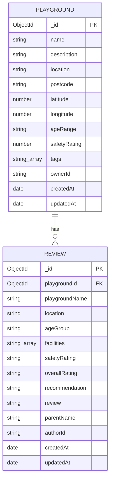

# SpielSpot Backend

Backend API for the SpielSpot playground discovery platform. The frontend reuses the existing SpielSpot project under `frontend/`, and this backend provides CRUD APIs for two related entities, Playground and Review, with Clerk authentication.

- Author: **I-Chieh Liu**, individual project.
- Intended users: parents looking for playgrounds and sharing their experiences.
- Live backend: [spielspot.onrender.com](https://spielspot.onrender.com)
- Health endpoint: [GET /health](https://spielspot.onrender.com/health)
- Live frontend: [spielspot.netlify.app](https://spielspot.netlify.app/)
- Repository: [SpielSpot-v2](https://github.com/i-chieh-liu-88/SpielSpot-v2)
- Active schedule: [English timetable](docs/TIMELINE/SpielSpot-v2-timetable-EN.md).
- Submission review: [requirements and remaining gaps](docs/submission-checklist.md).

Full API plan and ERD: [`docs/api-plan.md`](./docs/api-plan.md). Development log: [`docs/day1-log.md`](./docs/day1-log.md).

See the [current API request and response examples](docs/api-plan.md#current-api-examples-october-16)
for reads, authenticated writes and errors. Use your own Clerk bearer token;
do not store a real token in documentation or commits.

## Netlify frontend routing

The frontend uses client-side routes. `frontend/public/_redirects` is copied into
`frontend/dist` during the Vite build so Netlify serves `index.html` for direct
visits and refreshes of routes such as `/playgrounds/:id`. Keep the Netlify
publish directory set to `frontend/dist`.

## Playground deletion policy (deployed October 15)

`DELETE /api/playgrounds/:id` requires a signed-in owner. If related reviews
exist, the API returns `409` with `Cannot delete a playground with reviews` and
keeps both the playground and its reviews. A failed review lookup prevents
deletion. This check and deletion are separate database operations; concurrent
review creation is not protected by a transaction. Local route tests use mocked
models and Clerk. Render deployed commit `af86219` on October 15. Live checks
confirmed signed-out 401; the user reported non-owner 403 and owner 409, then
confirmed the playground and its review remained after the 409 response.

## Tech Stack

- Node.js + Express
- MongoDB Atlas + Mongoose
- Clerk (JWT authentication)
- Zod (input validation)
- helmet / cors / express-rate-limit (security middleware)

## Installation

```bash
# From the repository root, with Node.js 22.12 or newer
npm --prefix frontend install
npm --prefix backend install
```

## Environment Variables

Copy `backend/.env.example` to `backend/.env` and fill in your own values.
Copy `frontend/.env.example` to `frontend/.env.local` for the frontend.
Keep the Clerk secret key on the backend; only the publishable key belongs in
frontend variables. Both sides must use the same Clerk instance.
Do not commit local environment files.

```
MONGODB_URI=mongodb+srv://<username>:<password>@cluster0.xxxxx.mongodb.net/spielspot?retryWrites=true&w=majority
PORT=5000
CLIENT_URL=http://localhost:5173
CLERK_SECRET_KEY=sk_test_xxxxx
CLERK_PUBLISHABLE_KEY=pk_test_xxxxx
```

- `MONGODB_URI`: MongoDB Atlas connection string
- `CLERK_SECRET_KEY` / `CLERK_PUBLISHABLE_KEY`: must belong to the same Clerk application as the frontend's `VITE_CLERK_PUBLISHABLE_KEY`

## Running the Server

```bash
# Terminal 1, from the repository root
npm --prefix backend start
# Terminal 2
npm run dev
```

A successful start prints:

```
MongoDB connected
Server running on port 5000
```

## API Endpoints

The frontend reads playgrounds and reviews from the backend API. Signed-in
users can submit reviews. Review authors can edit review text and overall
rating through `PATCH /api/reviews/:id`; the frontend includes a Clerk bearer
token, and the backend enforces ownership. Review editing and filtering passed
live checks reported on October 13. The frontend uses `VITE_API_BASE_URL` or
`http://localhost:5000`.

The local Add playground form now sends `POST /api/playgrounds` with a Clerk
bearer token. It validates input, blocks duplicate submissions while saving,
keeps input after a failed save, and opens the detail page or review form after
success. The backend assigns `ownerId` from the authenticated user. Photos are
local previews only and are not uploaded. Playground edit-mode saving remains
disabled. Live creation and refresh retrieval passed on October 15.

The playground list sends location, age range and tag filters to the API.
Location matches part of an address without case sensitivity; age range is an
exact match; tags match any selected value. Reset clears the API filters, while
Show all also clears the URL keyword search. Review saves refresh the displayed
data and show a success message without reloading the page.

The local playground browsing update uses a vertical results list beside a
sticky map on desktop. Smaller screens start with the list and provide List/Map
buttons. Address lookup moves the map; the separate address filter narrows API
results. Filters can be expanded when needed. Moving the map keeps the list
unchanged until Search this area is pressed. Mouse-wheel map zoom is disabled;
the map retains zoom controls. The functional browsing update reached the live
frontend on October 15.

| Method | Endpoint                     | Description                      | Auth            |
| ------ | ---------------------------- | -------------------------------- | --------------- |
| GET    | /health                      | Check that the API responds      | No              |
| GET    | /api/playgrounds             | Get all playgrounds              | No              |
| GET    | /api/playgrounds/:id         | Get a single playground          | No              |
| POST   | /api/playgrounds             | Create a playground              | Yes             |
| PATCH  | /api/playgrounds/:id         | Update (owner only)              | Yes + ownership |
| DELETE | /api/playgrounds/:id         | Delete (owner only)              | Yes + ownership |
| GET    | /api/playgrounds/:id/reviews | Get all reviews for a playground | No              |
| POST   | /api/playgrounds/:id/reviews | Create a review                  | Yes             |
| PATCH  | /api/reviews/:id             | Update own review                | Yes + ownership |
| DELETE | /api/reviews/:id             | Delete own review                | Yes + ownership |

Unknown routes return JSON with status 404. Malformed JSON returns status 400.
Unexpected server errors return a generic 500 message without internal details.
`/health` checks that the API responds; it does not check the database connection.

Full request/response formats is in [`docs/api-plan.md`](./docs/api-plan.md).

## ERD

> GitHub automatically renders the Mermaid syntax below as a diagram, so no separate image file is needed



Relationship: `Playground 1 --- N Review` (Review stores `playgroundId` as a foreign key)

## Security

- Clerk JWT authentication (`requireLogin` middleware)
- Ownership checks: only the resource owner can PATCH/DELETE
- Input validation with Zod
- `helmet`, `cors` (whitelisted frontend origin), `express-rate-limit`
- Centralized error handler that never leaks internal stack traces
- Secrets stored in `.env`, excluded via `.gitignore`

## Current Status

- Done: The Render backend provides Playground and Review APIs with Clerk authentication, ownership checks, validation, and security middleware. The frontend reads playgrounds and reviews from the API and can submit reviews.
- Verified live on October 13: Review editing and the API filter UI, based on the reported live checks.
- Verified locally on October 14: Playground creation, detail navigation and retrieval after refresh in development and production preview. A failed network request preserved input and restored the Save button. Lint and 55 frontend tests across 20 files passed. The final build also passed after the banner and translation edits, with the existing chunk-size warning.
- Verified October 15: live authenticated creation and refresh retrieval, and backend deletion protection deployed as `af86219`. Local checks passed 42 backend tests, 64 frontend tests, lint and build. Photos remain preview only; playground edit-mode saving remains disabled.

## Verification commands

Run from the repository root:

```bash
npm run lint
npm --prefix backend test -- --runInBand
npm test
npm run build
npm run preview
```

Backend tests mock Clerk and database models and need no `.env` or Atlas access.
The frontend service tests in `frontend/src/services/playgrounds.test.ts` call
an API and require a running, populated backend. Start the backend before the
full frontend suite. A build alone does not test sign-in or database access.
Use the preview URL printed by Vite, normally `http://localhost:4173`.
`VITE_API_BASE_URL` defaults to `http://localhost:5000`; use the Render origin
for deployment. Set Render's `CLIENT_URL` to the Netlify frontend origin.

## Known backend limits

Local October 16 validation update: GET filters now validate scalar types,
lengths and tag counts, and escape location regex symbols. Review POST/PATCH
ratings must be strings 1 to 5. All 76 backend tests passed; these changes still
need commit, deployment and live verification. See the API examples for limits.

- Clerk uses a development instance. Production setup needs separate domain
  and key configuration; do not replace only one side's keys.
- Review creation can race with playground deletion because the related-data
  check and deletion are separate operations. The 409 check does not solve this.
- The October 16 backend npm audit reported 19 moderate findings in the Jest
  development dependency tree and zero with `--omit=dev`. This is a dependency
  report, not a full security audit. Do not force the suggested major Jest
  downgrade without checking compatibility.
