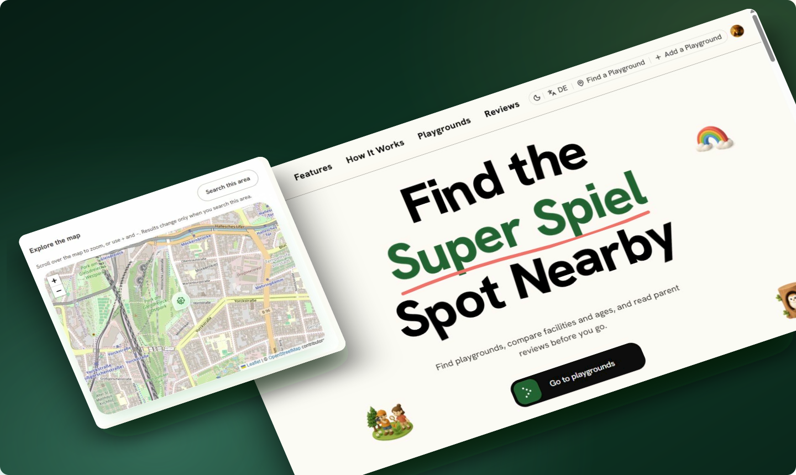
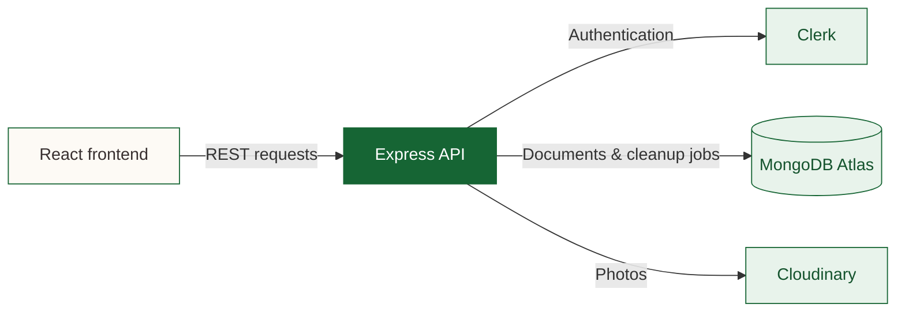

<p align="center">
  <a href="https://spielspot.netlify.app/">
    
  </a>
</p>

<h1 align="center">SpielSpot</h1>

<p align="center">
  <strong>Find your next playground.</strong><br>
  Explore places to play. Compare facilities. Share parent reviews.
</p>

<p align="center">
  <a href="https://spielspot.netlify.app/">Website</a> ·
  <a href="https://spielspot.onrender.com/">Backend API</a> ·
  <a href="docs/api-plan.md">API documentation</a> ·
  <a href="https://spielspot.onrender.com/health">Health check</a>
</p>

[](https://spielspot.netlify.app/)

<p align="center"><sub>Actual SpielSpot interfaces · Map data © <a href="https://www.openstreetmap.org/copyright">OpenStreetMap contributors</a></sub></p>

<p align="center">
  <a href="#overview">Overview</a> ·
  <a href="#backend">Backend</a> ·
  <a href="#local-setup">Local setup</a> ·
  <a href="#api">API</a> ·
  <a href="#verification">Verification</a> ·
  <a href="#documentation">Documentation</a>
</p>

## Overview

**Author:** I-Chieh Liu · Individual End-of-Module Backend Project

SpielSpot helps parents find playgrounds, compare facilities and age ranges, and share reviews. The React frontend connects to an Express REST API, MongoDB Atlas, Clerk authentication and Cloudinary photo storage.

- **Discover** playgrounds by location and explore them on the map.
- **Compare** facilities, listed ages, photos and community reviews.
- **Contribute** a playground, upload photos or share a review after signing in.

Browsing needs no account. Writes save real data, so share content you have permission to publish.

> **Release status · October 19, 2026**
>
> The latest backend is live on Render. Owner editing works in the new local frontend build, but Netlify has paused production deployments after the team exhausted its deployment credits. The public website still uses the previous edit form. [Release and verification details](docs/photo-cleanup.md).

### Try it

1. Open the [website](https://spielspot.netlify.app/) and choose **Find a Playground**.
2. Search or filter the list, explore the map, and open a listing for photos and reviews.
3. Sign in to add a playground with up to five photos or write a review. Review authors can edit their own reviews.

## Backend

Two related entities form the core of the API: **Playground** and **Review**. Each review references one playground. The [API plan](docs/api-plan.md) includes the ERD, technology choices and request/response examples.

| Area | Implementation |
| --- | --- |
| **REST & persistence** | MongoDB Atlas storage; CRUD endpoints for playgrounds and reviews; location, age and facility filters. |
| **Identity & ownership** | Clerk bearer tokens; server-assigned owner IDs; owner/author checks before updates and deletions. |
| **Validation & security** | Zod input validation, Helmet, configured CORS, rate limiting and a central error handler. |
| **Related data** | A playground with reviews returns `409` on deletion. MongoDB transactions coordinate review creation and playground deletion. |
| **Photos & recovery** | Owner-only Cloudinary uploads, file validation, resizing and metadata removal. Durable cleanup jobs support retries after failures. |

### Architecture



| Frontend | Backend | Services |
| --- | --- | --- |
| React · TypeScript · Vite | Node.js · Express · Mongoose · Zod | MongoDB Atlas · Clerk · Cloudinary |
| TanStack Router · Leaflet | Helmet · CORS · express-rate-limit | Netlify frontend · Render backend |

## Local setup

Use **Node.js 22.12 or newer** and npm. You need a MongoDB Atlas database, a Clerk application and Cloudinary credentials for photo uploads. Use a separate database for local testing. Review creation and playground deletion require MongoDB transaction support, which Atlas provides.

### Install

From the repository root:

```bash
npm --prefix frontend install
npm --prefix backend install
```

### Configure

Copy the supplied templates and fill in your own values:

| Template | Local file | Configuration |
| --- | --- | --- |
| `backend/.env.example` | `backend/.env` | MongoDB URI, Clerk keys, frontend origin and Cloudinary credentials |
| `frontend/.env.example` | `frontend/.env.local` | API base URL and Clerk publishable key |

Both sides must use the same Clerk instance. Keep secret keys out of frontend variables and Git.

The default API address is `http://localhost:5000`; the frontend uses `http://localhost:5173`. If Vite chooses another port, update the backend's `CLIENT_URL` and restart it. Keep `TRUST_PROXY_HOPS=0` for direct local access and `PROXY_DIAGNOSTICS_ENABLED=false`.

### Start

Run each command in a separate terminal from the repository root:

```bash
# Terminal 1 · Backend
npm --prefix backend start
```

```bash
# Terminal 2 · Frontend
npm run dev
```

Open the local URL printed by Vite.

## API

**Base URL:** [https://spielspot.onrender.com](https://spielspot.onrender.com/)

| Method | Route | Access |
| --- | --- | --- |
| GET | `/health` | Public; API response check, not database health |
| GET | `/api/playgrounds` | Public; supports filters |
| GET | `/api/playgrounds/:id` | Public |
| POST | `/api/playgrounds` | Signed-in user |
| PATCH / DELETE | `/api/playgrounds/:id` | Playground owner |
| POST | `/api/playgrounds/:id/photos` | Playground owner; up to five photos |
| GET | `/api/playgrounds/:id/reviews` | Public |
| POST | `/api/playgrounds/:id/reviews` | Signed-in user |
| PATCH / DELETE | `/api/reviews/:id` | Review author |

Photo uploads accept JPEG, PNG and WebP files up to **5 MB and 25 megapixels each**. The first photo becomes the cover. The legacy single-photo endpoint, `POST /api/playgrounds/:id/photo`, remains available.

### Example responses

A read-only request to `GET /health` returns HTTP 200:

```json
{"success":true,"status":"ok"}
```

A protected request without a valid signed-in user returns HTTP 401:

```json
{"success":false,"error":"Please login"}
```

[Request bodies, responses and error cases →](docs/api-plan.md#current-api-examples-october-19)

## Verification

**Latest recorded checks · October 19, 2026**

| Backend tests | Frontend tests | Lint | Production build |
| --- | --- | --- | --- |
| 120 passed | 80 passed | Passed | Passed, with the existing bundle-size warning |

Run from the repository root:

```bash
npm run lint
npm --prefix backend test -- --runInBand
npm test
npm run build
npm run preview
```

Automated tests cover validation, authentication and ownership responses, deletion protection, uploads, proxy handling and frontend behavior. These suites mock external services.

Separate Atlas checks used an isolated temporary database for both review/delete race orders and rollback. Live checks covered photo upload, photos after refresh, filtering, pagination and selected API responses. The deployed cleanup worker removed all generated assets from the authorized cleanup test. Detailed evidence and its scope are in the [submission checklist](docs/submission-checklist.md) and [cleanup notes](docs/photo-cleanup.md).

## Known limitations

- **Clerk:** the demo uses development keys. Production-instance setup is deferred until a suitable owned domain is available.
- **Frontend publication:** Netlify skipped release `5cf229f` after deployment credits ran out. Owner editing works locally; the public website still uses the previous frontend.
- **Cloud recovery:** MongoDB and Cloudinary cannot share a transaction. Cleanup jobs retry while the server runs; persistent provider failures need investigation. Older untracked orphan images remain outside this recovery mechanism.
- **Verification scope:** concurrency tests covered controlled database race orders, not simultaneous authenticated production HTTP requests. Proxy checks support the tested three-hop Render path; live multi-client/IPv6 rate-limit isolation remains unverified. Diagnostics stay disabled.

## Documentation

| Read | Find |
| --- | --- |
| [API plan & ERD](docs/api-plan.md) | Data model, technology rationale, endpoints, requests and responses |
| [Backend handoff](docs/backend-handoff.md) | Integration and deployment notes |
| [Submission checklist](docs/submission-checklist.md) | Brief requirements, verification evidence and submission status |
| [Photo cleanup](docs/photo-cleanup.md) | Upload recovery, cleanup retries and release checks |
| [Project timetable](docs/TIMELINE/SpielSpot-v2-timetable-EN.md) | Plan and active schedule |

<details>
<summary>Development history</summary>

[Archived README development history](docs/readme-history.md) contains dated records with superseded statements. Use the current README for the project overview and the documents above for verification scope.

</details>

---

<p align="center">
  <strong>SpielSpot</strong><br>
  Built by <a href="https://github.com/i-chieh-liu-88">I-Chieh Liu</a>
</p>
