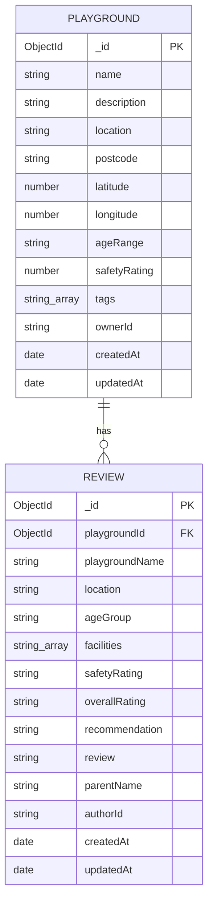

# SpielSpot Backend

Backend API for the SpielSpot playground discovery platform. The frontend reuses the existing SpielSpot project under `frontend/`, and this backend provides CRUD APIs for two related entities, Playground and Review, with Clerk authentication.

Full API plan and ERD: [`docs/api-plan.md`](./docs/api-plan.md). Development log: [`docs/day1-log.md`](./docs/day1-log.md).

## Netlify frontend routing

The frontend uses client-side routes. `frontend/public/_redirects` is copied into
`frontend/dist` during the Vite build so Netlify serves `index.html` for direct
visits and refreshes of routes such as `/playgrounds/:id`. Keep the Netlify
publish directory set to `frontend/dist`.

## Playground deletion policy (local update, October 15)

`DELETE /api/playgrounds/:id` requires a signed-in owner. If related reviews
exist, the API returns `409` with `Cannot delete a playground with reviews` and
keeps both the playground and its reviews. A failed review lookup prevents
deletion. This check and deletion are separate database operations; concurrent
review creation is not protected by a transaction. Local route tests use mocked
models and Clerk. This change still needs deployment and database verification.

## Tech Stack

- Node.js + Express
- MongoDB Atlas + Mongoose
- Clerk (JWT authentication)
- Zod (input validation)
- helmet / cors / express-rate-limit (security middleware)

## Installation

```bash
cd backend
npm install
```

## Environment Variables

Create a `.env` file in the `backend/` root:

```
MONGODB_URI=mongodb+srv://<username>:<password>@cluster0.xxxxx.mongodb.net/spielspot?retryWrites=true&w=majority
PORT=5000
CLERK_SECRET_KEY=sk_test_xxxxx
CLERK_PUBLISHABLE_KEY=pk_test_xxxxx
```

- `MONGODB_URI`: MongoDB Atlas connection string
- `CLERK_SECRET_KEY` / `CLERK_PUBLISHABLE_KEY`: must belong to the same Clerk application as the frontend's `VITE_CLERK_PUBLISHABLE_KEY`

## Running the Server

```bash
npm start
```

A successful start prints:

```
MongoDB connected
Server running on port 5000
```

## API Endpoints

The frontend reads playgrounds and reviews from the backend API. Signed-in
users can submit reviews. Review authors can edit review text and overall
rating through `PATCH /api/reviews/:id`; the frontend includes a Clerk bearer
token, and the backend enforces ownership. Review editing and filtering passed
live checks reported on October 13. The frontend uses `VITE_API_BASE_URL` or
`http://localhost:5000`.

The local Add playground form now sends `POST /api/playgrounds` with a Clerk
bearer token. It validates input, blocks duplicate submissions while saving,
keeps input after a failed save, and opens the detail page or review form after
success. The backend assigns `ownerId` from the authenticated user. Photos are
local previews only and are not uploaded. Playground edit-mode saving remains
disabled. The creation form update has not yet been deployed.

The playground list sends location, age range and tag filters to the API.
Location matches part of an address without case sensitivity; age range is an
exact match; tags match any selected value. Reset clears the API filters, while
Show all also clears the URL keyword search. Review saves refresh the displayed
data and show a success message without reloading the page.

The local playground browsing update uses a vertical results list beside a
sticky map on desktop. Smaller screens start with the list and provide List/Map
buttons. Address lookup moves the map; the separate address filter narrows API
results. Filters can be expanded when needed. Moving the map keeps the list
unchanged until Search this area is pressed. Mouse-wheel map zoom is disabled;
the map retains zoom controls. These browsing changes are not yet deployed.

| Method | Endpoint                     | Description                      | Auth            |
| ------ | ---------------------------- | -------------------------------- | --------------- |
| GET    | /health                      | Check that the API responds      | No              |
| GET    | /api/playgrounds             | Get all playgrounds              | No              |
| GET    | /api/playgrounds/:id         | Get a single playground          | No              |
| POST   | /api/playgrounds             | Create a playground              | Yes             |
| PATCH  | /api/playgrounds/:id         | Update (owner only)              | Yes + ownership |
| DELETE | /api/playgrounds/:id         | Delete (owner only)              | Yes + ownership |
| GET    | /api/playgrounds/:id/reviews | Get all reviews for a playground | No              |
| POST   | /api/playgrounds/:id/reviews | Create a review                  | Yes             |
| PATCH  | /api/reviews/:id             | Update own review                | Yes + ownership |
| DELETE | /api/reviews/:id             | Delete own review                | Yes + ownership |

Unknown routes return JSON with status 404. Malformed JSON returns status 400.
Unexpected server errors return a generic 500 message without internal details.
`/health` checks that the API responds; it does not check the database connection.

Full request/response formats is in [`docs/api-plan.md`](./docs/api-plan.md).

## ERD

> GitHub automatically renders the Mermaid syntax below as a diagram, so no separate image file is needed



Relationship: `Playground 1 --- N Review` (Review stores `playgroundId` as a foreign key)

## Security

- Clerk JWT authentication (`requireLogin` middleware)
- Ownership checks: only the resource owner can PATCH/DELETE
- Input validation with Zod
- `helmet`, `cors` (whitelisted frontend origin), `express-rate-limit`
- Centralized error handler that never leaks internal stack traces
- Secrets stored in `.env`, excluded via `.gitignore`

## Current Status

- Done: The Render backend provides Playground and Review APIs with Clerk authentication, ownership checks, validation, and security middleware. The frontend reads playgrounds and reviews from the API and can submit reviews.
- Verified live on October 13: Review editing and the API filter UI, based on the reported live checks.
- Verified locally on October 14: Playground creation, detail navigation and retrieval after refresh in development and production preview. A failed network request preserved input and restored the Save button. Lint and 55 frontend tests across 20 files passed. The final build also passed after the banner and translation edits, with the existing chunk-size warning.
- Pending: Deploy and verify the creation form update. Photos are preview only; playground edit-mode saving remains disabled. The user confirmed the English banner and German translation in development.
