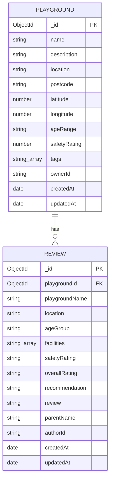

# SpielSpot Backend

Backend API for the SpielSpot playground discovery platform. The frontend reuses the existing SpielSpot project under `frontend/`, and this backend provides CRUD APIs for two related entities, Playground and Review, with Clerk authentication.

- Author: **I-Chieh Liu**, individual project.
- Intended users: parents looking for playgrounds and sharing their experiences.
- Live backend: [spielspot.onrender.com](https://spielspot.onrender.com)
- Health endpoint: [GET /health](https://spielspot.onrender.com/health)
- Live frontend: [spielspot.netlify.app](https://spielspot.netlify.app/)
- Repository: [SpielSpot-v2](https://github.com/i-chieh-liu-88/SpielSpot-v2)
- Active schedule: [English timetable](docs/TIMELINE/SpielSpot-v2-timetable-EN.md).
- Submission review: [requirements and remaining gaps](docs/submission-checklist.md).

Full API plan and ERD: [`docs/api-plan.md`](./docs/api-plan.md). Development log: [`docs/day1-log.md`](./docs/day1-log.md).

See the [current API request and response examples](docs/api-plan.md#current-api-examples-october-16)
for reads, authenticated writes and errors. Use your own Clerk bearer token;
do not store a real token in documentation or commits.

## Netlify frontend routing

The frontend uses client-side routes. `frontend/public/_redirects` is copied into
`frontend/dist` during the Vite build so Netlify serves `index.html` for direct
visits and refreshes of routes such as `/playgrounds/:id`. Keep the Netlify
publish directory set to `frontend/dist`.

## Playground deletion policy (deployed October 15)

`DELETE /api/playgrounds/:id` requires a signed-in owner. If related reviews
exist, the API returns `409` with `Cannot delete a playground with reviews` and
keeps both the playground and its reviews. A failed review lookup prevents
deletion. This check and deletion are separate database operations; concurrent
review creation is not protected by a transaction. Local route tests use mocked
models and Clerk. Render deployed commit `af86219` on October 15. Live checks
confirmed signed-out 401; the user reported non-owner 403 and owner 409, then
confirmed the playground and its review remained after the 409 response.

## Tech Stack

- Node.js + Express
- MongoDB Atlas + Mongoose
- Clerk (JWT authentication)
- Zod (input validation)
- helmet / cors / express-rate-limit (security middleware)

## Installation

```bash
# From the repository root, with Node.js 22.12 or newer
npm --prefix frontend install
npm --prefix backend install
```

## Environment Variables

Copy `backend/.env.example` to `backend/.env` and fill in your own values.
Copy `frontend/.env.example` to `frontend/.env.local` for the frontend.
Keep the Clerk secret key on the backend; only the publishable key belongs in
frontend variables. Both sides must use the same Clerk instance.
Do not commit local environment files.

```
MONGODB_URI=mongodb+srv://<username>:<password>@cluster0.xxxxx.mongodb.net/spielspot?retryWrites=true&w=majority
PORT=5000
CLIENT_URL=http://localhost:5173
CLERK_SECRET_KEY=sk_test_xxxxx
CLERK_PUBLISHABLE_KEY=pk_test_xxxxx
```

- `MONGODB_URI`: MongoDB Atlas connection string
- `CLERK_SECRET_KEY` / `CLERK_PUBLISHABLE_KEY`: must belong to the same Clerk application as the frontend's `VITE_CLERK_PUBLISHABLE_KEY`

## Running the Server

```bash
# Terminal 1, from the repository root
npm --prefix backend start
# Terminal 2
npm run dev
```

A successful start prints:

```
MongoDB connected
Server running on port 5000
```

## API Endpoints

The frontend reads playgrounds and reviews from the backend API. Signed-in
users can submit reviews. Review authors can edit review text and overall
rating through `PATCH /api/reviews/:id`; the frontend includes a Clerk bearer
token, and the backend enforces ownership. Review editing and filtering passed
live checks reported on October 13. The frontend uses `VITE_API_BASE_URL` or
`http://localhost:5000`.

The local Add playground form now sends `POST /api/playgrounds` with a Clerk
bearer token. It validates input, blocks duplicate submissions while saving,
keeps input after a failed save, and opens the detail page or review form after
success. The backend assigns `ownerId` from the authenticated user. The local creation flow now uploads an optional photo to Cloudinary. Playground edit-mode saving remains
disabled. Live creation and refresh retrieval passed on October 15.

The playground list sends location, age range and tag filters to the API.
Location matches part of an address without case sensitivity; age range is an
exact match; tags match any selected value. Reset clears the API filters, while
Show all also clears the URL keyword search. Review saves refresh the displayed
data and show a success message without reloading the page.

The local playground browsing update uses a vertical results list beside a
sticky map on desktop. Smaller screens start with the list and provide List/Map
buttons. Address lookup moves the map; the separate address filter narrows API
results. Filters can be expanded when needed. Moving the map keeps the list
unchanged until Search this area is pressed. Mouse-wheel map zoom is disabled;
the map retains zoom controls. The functional browsing update reached the live
frontend on October 15.

| Method | Endpoint                     | Description                      | Auth            |
| ------ | ---------------------------- | -------------------------------- | --------------- |
| GET    | /health                      | Check that the API responds      | No              |
| GET    | /api/playgrounds             | Get all playgrounds              | No              |
| GET    | /api/playgrounds/:id         | Get a single playground          | No              |
| POST   | /api/playgrounds             | Create a playground              | Yes             |
| PATCH  | /api/playgrounds/:id         | Update (owner only)              | Yes + ownership |
| DELETE | /api/playgrounds/:id         | Delete (owner only)              | Yes + ownership |
| GET    | /api/playgrounds/:id/reviews | Get all reviews for a playground | No              |
| POST   | /api/playgrounds/:id/reviews | Create a review                  | Yes             |
| PATCH  | /api/reviews/:id             | Update own review                | Yes + ownership |
| DELETE | /api/reviews/:id             | Delete own review                | Yes + ownership |

Unknown routes return JSON with status 404. Malformed JSON returns status 400.
Unexpected server errors return a generic 500 message without internal details.
`/health` checks that the API responds; it does not check the database connection.

Full request/response formats is in [`docs/api-plan.md`](./docs/api-plan.md).

## ERD

> GitHub automatically renders the Mermaid syntax below as a diagram, so no separate image file is needed



Relationship: `Playground 1 --- N Review` (Review stores `playgroundId` as a foreign key)

## Security

- Clerk JWT authentication (`requireLogin` middleware)
- Ownership checks: only the resource owner can PATCH/DELETE
- Input validation with Zod
- `helmet`, `cors` (whitelisted frontend origin), `express-rate-limit`
- Centralized error handler that never leaks internal stack traces
- Secrets stored in `.env`, excluded via `.gitignore`

## Final verification snapshot (October 19, 2026)

- Multi-photo upload was deployed and verified live on October 18, including five saved photos, switching and retrieval after refresh.
- Latest local checks: 89 backend tests and 74 frontend tests passed. Backend tests mock Clerk, MongoDB and cloud services; frontend service tests mock HTTP responses.
- The list uses ten results per page, shared pending reads and explicit area search. Single-result map bounds cap initial zoom to avoid NaN errors.
- Final frontend release and submission receipt are pending until verified below. Optional visual polish is not part of the backend assessment.

## Historical status

- Done: The Render backend provides Playground and Review APIs with Clerk authentication, ownership checks, validation, and security middleware. The frontend reads playgrounds and reviews from the API and can submit reviews.
- Verified live on October 13: Review editing and the API filter UI, based on the reported live checks.
- Verified locally on October 14: Playground creation, detail navigation and retrieval after refresh in development and production preview. A failed network request preserved input and restored the Save button. Lint and 55 frontend tests across 20 files passed. The final build also passed after the banner and translation edits, with the existing chunk-size warning.
- Verified October 15: live authenticated creation and refresh retrieval, and backend deletion protection deployed as `af86219`. Local checks passed 42 backend tests, 64 frontend tests, lint and build. Photos remain preview only; playground edit-mode saving remains disabled.

## Verification commands

Run from the repository root:

```bash
npm run lint
npm --prefix backend test -- --runInBand
npm test
npm run build
npm run preview
```

Backend tests mock Clerk and database models and need no `.env` or Atlas access.
The frontend service tests in `frontend/src/services/playgrounds.test.ts` call
an API and require a running, populated backend. Start the backend before the
full frontend suite. A build alone does not test sign-in or database access.
Use the preview URL printed by Vite, normally `http://localhost:4173`.
`VITE_API_BASE_URL` defaults to `http://localhost:5000`; use the Render origin
for deployment. Set Render's `CLIENT_URL` to the Netlify frontend origin.

## Known backend limits

October 16 validation update, deployed on Render as `e2cb200`: GET filters validate scalar types,
lengths and tag counts, and escape location regex symbols. Review POST/PATCH
ratings must be strings 1 to 5. All 76 backend tests passed. Live GET checks
confirmed literal search, normal filtering and 400 for duplicate/oversized
queries. Authenticated rating POST/PATCH live checks remain pending.
See the API examples for limits.

- Clerk uses a development instance. Production setup needs separate domain
  and key configuration; do not replace only one side's keys.
- Review creation can race with playground deletion because the related-data
  check and deletion are separate operations. The 409 check does not solve this.
- The October 16 backend npm audit reported 19 moderate findings in the Jest
  development dependency tree and zero with `--omit=dev`. This is a dependency
  report, not a full security audit. Do not force the suggested major Jest
  downgrade without checking compatibility.

## October 16 photo upload update (local, not deployed)

The creation form now supports one optional Cloudinary photo. This supersedes
older preview-only notes for local creation. General edit saving is still disabled.

Set CLOUDINARY_CLOUD_NAME, CLOUDINARY_API_KEY and CLOUDINARY_API_SECRET privately
in backend/.env and restart the backend. Never put the API secret in frontend
variables or Git. Set these same variables privately on Render before deployment.

POST /api/playgrounds/:id/photo accepts multipart form data with one photo field.
Clerk authentication and ownership checks run before file processing. Only JPEG,
PNG and WebP up to 5 MB and 25 megapixels are accepted. The backend decodes the
bytes, removes metadata and converts the image to WebP within 1600 by 1600 pixels.
MongoDB stores imageUrl and a hidden imagePublicId. Uploaded images are public.
Only upload photos that may be shared publicly.

The frontend first creates the details, then uploads the photo. If photo upload
fails, it retains the created ID and retries without another creation request.
Details stay locked after creation; users may continue without the photo.
Replacement and deletion attempt cloud cleanup. Cleanup failures log a generic
warning and can leave unused assets requiring manual cleanup. Cloud and MongoDB
operations do not share a transaction. An ambiguous network failure during
creation still needs manual checking before retrying.

Responses: 400 invalid file or ID, 401 signed out, 403 not the owner, 404 missing
playground, 409 playground changed during upload, 502 provider failure, 503 missing
storage configuration, 500 database failure. Database save failures trigger an
attempt to remove the newly uploaded asset.

Verified locally: 84 backend tests, 67 frontend tests, lint and production build.
A generated Cloudinary image uploaded and was deleted successfully. Production preview file selection showed the selected image. Signed-in creation and refresh retrieval passed on localhost:5173 for test record 6ad1f17fc2be5443c729bf3d. The same photo loaded in localhost:4173 production preview. Live deployment checks remain pending.

### October 16 live photo verification

The photo feature is deployed: Render runs 8639af1 and the Netlify frontend
includes the photo flow and upload error reasons. Initial live uploads failed
with Cloudinary signature rejection (provider 401, API 502). After the user
corrected Render credentials and redeployed, retrying the existing saved record
succeeded without creating another playground.

Verified on https://spielspot.netlify.app/playgrounds/6ad212c1ab82eabf8524899b:
the Cloudinary image loaded before and after browser refresh. The record is
named TEST Oct 16 Photo Credentials Retest. Its green image is generated test
data, not a real playground photo. The test record remains in the database.
This supersedes the pending live deployment status in the local photo update.
Live image replacement and photo cleanup on playground deletion are not yet
verified; their implementation and automated checks are separate evidence.

### Five-photo album extension (local, not deployed)

Creation now accepts up to five JPEG, PNG or WebP photos, each up to 5 MB and
25 megapixels. The first selected photo is the cover. Users can remove selected
photos before submission; removing the cover promotes the next photo. Detail
pages provide labeled thumbnail buttons and a photo counter. Existing imageUrl
records remain readable without migration. Edit mode still cannot save changes,
but continues showing existing photos.

POST /api/playgrounds/:id/photos accepts repeated multipart photos fields and
replaces the complete album. The previous singular photo endpoint remains
available and replaces the album with one photo. The server validates all files
before cloud uploads, processes them sequentially, and updates MongoDB only when
all uploads succeed. A failed batch attempts cleanup of every newly uploaded
asset and leaves the old album intact. Retries reuse the created playground ID.
A photoRevision compare-and-update rejects stale concurrent album saves with
409 and attempts cleanup of the losing upload. This protects album replacement;
it does not change the deferred review creation/deletion concurrency limitation.

imageUrls stores ordered display URLs. imagePublicIds is hidden from normal
queries and used for replacement/deletion cleanup. Legacy imageUrl and hidden
imagePublicId retain the cover for compatibility. Cleanup failures log a fixed
warning and may leave unused cloud assets requiring manual cleanup.

Backend tests: 89 passed, including five-photo order, a sixth-file rejection,
whole-batch validation, partial cloud failure cleanup, and stale revision handling.
Full authenticated multi-photo browser saving and live deployment remain pending.

### Five-photo local browser verification

On October 16, authenticated creation on localhost:5174 uploaded three generated
images to Cloudinary and saved their ordered URLs in MongoDB for test record
6ad2262eaf1dc0fc668ad088 (TEST Oct 16 Multi Photo Album). Switching to photo 3
worked; browser refresh retained all three photos. Production preview on
localhost:4173 switched to photos 2 and 3. At 390px width there was no horizontal
page overflow. The three solid-color images are synthetic test assets and the
record remains in the database. Existing single-photo records still load.

Final checks: 70 frontend tests, 89 backend tests, lint and build passed. The
existing bundle-size warning remains. The gallery extension passed scoped code
and screenshot review. Live multi-photo deployment is still pending; this
supersedes the pending local browser verification above, not the live status.
For the localhost:5174 test, the backend process was started with CLIENT_URL set
to http://localhost:5174. A backend restart must retain that setting when using
this port; the standard development fallback origins remain 5173 and 4173.

### October 18 multi-photo deployment

Deployment checks passed: frontend lint, 70 frontend tests, production build,
and 89 backend tests. The existing large-bundle warning remains. Render deployed
b03b0dd (five-photo API) before the frontend release. A signed-out request to the
live /photos endpoint returned 401 instead of the previous 404. Frontend commit
a864acc was pushed, and the Netlify production site displayed the new multi-photo
form and gallery. Local and deployed entry hashes differ because build environment
values differ; the live form and gallery behavior were checked in the browser.

The assistant opened existing test record 6ad2262eaf1dc0fc668ad088 on the live
website, switched to photo 3, confirmed the Cloudinary image loaded, and refreshed
the page with all three photos retained. This record was created during the
October 16 local integration test and is not a new production upload test.

A new three-photo live test form, TEST Oct 18 Live Multi Photo Deployment, was
prepared but not submitted: automatic approval review rejected the production
data creation because deployment authorization did not include that new record
and cloud upload. No workaround was attempted. Fresh authenticated live multi-photo
upload remains pending explicit authorization. This supersedes the pending
deployment status above, while retaining that verification gap. Timeline edits
were intentionally excluded from these deployment commits.

### October 18 authorized live multi-photo upload

After explicit user approval, the assistant submitted TEST Oct 18 Live Multi
Photo Deployment with three generated test images through the Netlify production
form. The Render multi-photo API saved the album and the detail page opened at
https://spielspot.netlify.app/playgrounds/6ad4d82fae38d5b10d54471d.
The first photo appeared as the cover. Switching to photo 3 loaded its Cloudinary
image. After browser refresh the gallery retained three photos, and switching
to photo 2 also loaded its image. The test record and images remain.

This completes the fresh authenticated live multi-photo upload check that was
previously pending approval. It does not establish live replacement/deletion
cleanup or concurrent-request behavior, which remain separate verification gaps.
No code changed for this check and no test suite was rerun.

## Final live checks (October 19, 2026)

- Release 6587704 was pushed to main and Netlify showed Published for that commit. The live site displayed the new map guidance.
- Live Berlin filtering returned one result without a map error. Reset restored 14 results, displayed as 10 and 4 across two pages.
- The existing five-photo listing loaded, the fifth photo rendered, and its details/gallery remained available after refresh. These checks did not create or delete data.
- Live API checks: GET /health 200; Berlin list GET 200; duplicate location query 400; unsigned playground POST 401. These checks do not re-establish every authenticated owner/non-owner path. Earlier live ownership checks remain dated evidence.
- Public GitHub returned 200. Final automated checks: 89 backend tests, 74 frontend tests, lint and production build passed. The existing bundle-size warning remains.
- User confirmed that submission only needs the GitHub and website links. Links are ready to hand over; instructor receipt and Slack delivery have not been confirmed.

## Proxy configuration (local implementation, not yet deployed)

TRUST_PROXY_HOPS accepts integers 0-5 and defaults to 0 (no trusted proxy).
Local direct access must keep 0. Do not set true. Configure the actual trusted
hop count only after verifying Render’s forwarding path and that clients cannot
reach Express through a shorter route. A one-hop test is a model, not evidence
that Render uses exactly one hop. Do not trust the leftmost X-Forwarded-For
entry without checking the proxy chain. This setting also affects protocol
and hostname handling. Local tests verify shared-IP rate limiting, separate
visitor buckets and forged prefix handling for the simulated one-hop path.
Keep the 100 requests per 15 minutes policy unchanged. Live topology, IPv6
and spoofed-header verification remain pending before enabling this setting.

Temporary proxy inspection: set PROXY_DIAGNOSTICS_ENABLED=true only during
verification. GET /api/diagnostics/proxy requires a Clerk bearer token and
returns header counts/format booleans only, with no-store. Disabled returns 404.
Counts alone do not establish which hop is the real visitor or prove spoof
resistance. Do not enable TRUST_PROXY_HOPS from counts alone. Turn diagnostics
off after inspection. This diagnostic preparation is local, not deployed.
