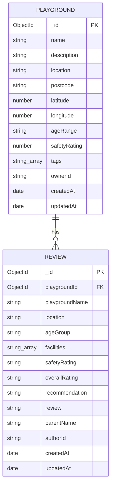

# SpielSpot Backend API Plan

Mini project planning document. The frontend reuses `frontend/` from `i-chieh-liu-88/SpielSpot-v2`; this document plans an entirely new `backend/`.

Purpose: help parents find playgrounds and share reviews. Playground is the
place listing; Review references one Playground through `playgroundId`.
Current implementation notes below reflect the October 16 review. The final
deadline is October 19, 2026, at 23:59 Europe/Berlin; the two-day sketch at the
end is historical and is not the active schedule.

## Tech Stack

- Runtime: Node.js + Express
- Database: MongoDB Atlas + Mongoose
- Auth: Clerk (verifies JWTs sent from the frontend)

### Why these choices (Tech Stack Rationale)

- **Node.js + Express**: JavaScript across the client and server reduces
  context switching. Express keeps routing, middleware and controllers explicit.
  A larger framework would add conventions this small API does not yet need.

- **MongoDB + Mongoose over a relational database**: the two core entities
  (Playground, Review) have a simple one-to-many relationship with no need
  for complex joins or multi-table transactions. Mongoose's schema
  validation plus Zod at the API layer gave enough structure without the
  overhead of migrations during fast iteration.
- **Clerk over a custom auth system**: building and securing password
  storage, session management, and token refresh correctly is a large
  surface area to get right. Clerk handles this, and both frontend and
  backend already shared the same provider, so verifying backend-issued
  JWTs was a natural fit.
- **Zod over express-validator**: schema-first validation reads closer to
  the TypeScript types already used on the frontend, supports `.partial()`
  for PATCH requests out of the box, and gives typed, composable schemas
  instead of per-field middleware chains.
- **Render over Vercel for the backend**: this is a long-running Express
  server with a persistent Mongoose connection, not a stateless function,
  so a traditional always-on host fit better than a serverless platform.

## ERD

> GitHub automatically renders the Mermaid syntax below as a diagram, so no separate image file is needed



Relationship: `Playground 1 --- N Review` (Review stores `playgroundId` as a foreign key)

## API Endpoints

| Method | Endpoint                     | Description                      | Auth required?  |
| ------ | ---------------------------- | -------------------------------- | --------------- |
| GET    | /api/playgrounds             | Get all playgrounds              | No              |
| GET    | /api/playgrounds/:id         | Get a single playground          | No              |
| POST   | /api/playgrounds             | Create a playground              | Yes             |
| PATCH  | /api/playgrounds/:id         | Update (owner only)              | Yes + ownership |
| DELETE | /api/playgrounds/:id         | Delete (owner only)              | Yes + ownership |
| GET    | /api/playgrounds/:id/reviews | Get all reviews for a playground | No              |
| POST   | /api/playgrounds/:id/reviews | Create a review                  | Yes             |
| PATCH  | /api/reviews/:id             | Edit user's review               | Yes + ownership |
| DELETE | /api/reviews/:id             | Delete own review                | Yes + ownership |

To load a playground with its reviews, request `GET /api/playgrounds/:id` and
`GET /api/playgrounds/:id/reviews` separately. The playground list
supports query filtering: `location` is a case-insensitive literal substring
search, `ageRange` matches exactly, and comma-separated `tags` match any value.
The October 16 local update validates query parameters with Zod: only single
strings and known keys are accepted. Location allows 200 characters, ageRange
80, and tags 1000 total with at most 10 nonempty values of 80 characters each.
Values are trimmed; empty filters mean no restriction. Regex symbols in location
are escaped. Invalid filters return 400 before database access.

> Note: `safetyRating` is a Number on Playground but a String on Review,
> matching the frontend's PlaygroundMutationInput vs CreateReviewInput types.

### Response Format

```json
// Success
{ "success": true, "data": { } }
// Failure
{ "success": false, "error": "message" }
```

### Example Error Responses

| Status | Example                                                                                      | When                                  |
| ------ | -------------------------------------------------------------------------------------------- | ------------------------------------- |
| 400    | `{ "success": false, "error": "latitude: Invalid input: expected number, received string" }` | Validation failure (Zod)              |
| 401    | `{ "success": false, "error": "Please login" }`                                              | Missing or invalid auth token         |
| 403    | `{ "success": false, "error": "Not allowed to edit this playground" }`                       | Logged in, but not the resource owner |
| 404    | `{ "success": false, "error": "Playground not found" }`                                      | Resource ID does not exist            |
| 409    | `{ "success": false, "error": "Cannot delete a playground with reviews" }`                    | Owner attempts deletion with related reviews |
| 429    | `{ "success": false, "error": "Too many requests, please try again later." }`                   | Rate limit exceeded |
| 500    | `{ "success": false, "error": "Internal server error" }`                                     | Unexpected server-side error          |

## Security Checklist

- Clerk JWT authentication through `clerkMiddleware()` and `requireLogin`
- Ownership check (only the owner can edit/delete their own data)
- Zod request-body validation, trimming selected strings and stripping unknown fields
- `helmet` (security headers)
- `cors` (whitelisting only the frontend origin)
- Rate limiting (`express-rate-limit`)
- Secrets stored in environment variables (`.env`, excluded from git)
- No server file upload endpoint. JPEG/PNG/WebP and 5 MB checks apply only to
  the frontend local preview; server upload validation is future work.
- Centralized error handling middleware, no stack trace leaks

## Current API examples (October 16)

Base URL: `https://spielspot.onrender.com`; local API: `http://localhost:5000`.
Replace `PLAYGROUND_ID` and `REVIEW_ID` with IDs returned by your requests.
Protected requests require `Authorization: Bearer YOUR_CLERK_TOKEN`. Obtain a
token from your own signed-in session for the configured Clerk instance.
All JSON request bodies require `Content-Type: application/json`.

### Reads

| Request | Expected result |
| --- | --- |
| `GET /health` | 200, `{"success":true,"status":"ok"}`; API process check only |
| `GET /api/playgrounds?location=Dresden&tags=park,outdoor` | 200, `{"success":true,"data":[...]}` |
| `GET /api/playgrounds/PLAYGROUND_ID` | 200, `{"success":true,"data":{"_id":"PLAYGROUND_ID",...}}` |
| `GET /api/playgrounds/PLAYGROUND_ID/reviews` | 200, `{"success":true,"data":[...]}`; no reviews gives an empty array |

The `...` markers above abbreviate fields; they are not literal JSON syntax.
For example, a list with no matches returns valid JSON:

```json
{"success":true,"data":[]}
```

```bash
curl https://spielspot.onrender.com/health
curl "https://spielspot.onrender.com/api/playgrounds?location=Dresden"
```

### Create a playground

`POST /api/playgrounds`, with a bearer token:

```json
{
  "name": "TEST API Example",
  "location": "Dresden",
  "latitude": 51.065,
  "longitude": 13.755,
  "description": "Test data only, not a verified playground listing.",
  "tags": ["Climbing"],
  "safetyRating": 3
}
```

Success: 201, `{"success":true,"data":{"_id":"PLAYGROUND_ID",...}}`.
The API sets `ownerId` from Clerk, not from the supplied body.
`name`, `location`, `latitude` and `longitude` are required. Latitude is between
-90 and 90; longitude between -180 and 180. Safety rating is between 1 and 5.

### Update or delete a playground

- `PATCH /api/playgrounds/PLAYGROUND_ID`, body `{"name":"TEST Updated Name"}`:
  owner receives 200 with the updated document in `data`. PATCH uses the partial
  playground Zod schema; unknown fields, including `ownerId`, are stripped.
- `DELETE /api/playgrounds/PLAYGROUND_ID`, no body: owner with no related reviews
  receives 200, `{"success":true,"data":null}`. With reviews, the API returns 409
  and preserves both entities. A non-owner receives 403 before the review check.

Only delete disposable test data you own. These example writes affect the live
database when sent to the live URL.

### Create, update or delete a review

`POST /api/playgrounds/PLAYGROUND_ID/reviews`, with a bearer token:

```json
{
  "playgroundName": "TEST API Example",
  "location": "Dresden",
  "ageGroup": "All ages",
  "facilities": ["Climbing"],
  "safetyRating": "3",
  "overallRating": "3",
  "review": "TEST REVIEW ONLY. This is not a real visit.",
  "parentName": "API test"
}
```

- Creation returns 201 and the review document in `data`. The server sets
  `playgroundId` from the URL and `authorId` from Clerk. A missing playground
  returns 404. Ratings on Review are strings, unlike Playground safety rating.
  The October 16 local update restricts both review ratings to strings `"1"`
  through `"5"` after trimming. Numbers, fractions and out-of-range values return
  400. PATCH applies the same rules to supplied fields; omitted fields stay unchanged.
- `PATCH /api/reviews/REVIEW_ID`, body
  `{"review":"TEST updated review","overallRating":"4"}`: the author receives
  200 with the updated review in `data`; a non-author receives 403.
- `DELETE /api/reviews/REVIEW_ID`, no body: the author receives 200,
  `{"success":true,"data":null}`; a non-author receives 403.

### Error and security boundaries

- No valid authenticated user: 401, `{"success":false,"error":"Please login"}`.
- Non-owner playground DELETE: 403,
  `{"success":false,"error":"Not allowed to delete this playground"}`.
- Owner DELETE with reviews: 409,
  `{"success":false,"error":"Cannot delete a playground with reviews"}`.
- Missing name on POST: 400, `{"success":false,"error":"name is required"}`.
- Malformed JSON: 400, `{"success":false,"error":"Invalid JSON format"}`.
- Unexpected server error: 500,
  `{"success":false,"error":"Internal server error"}`.

CORS allows configured `CLIENT_URL` plus ports 5173 and 4173 outside production.
CORS controls browser access; it is not authentication or a barrier to Postman.
The current limiter applies globally at 100 requests per 15 minutes per client IP.
Verify reverse-proxy/IP behavior before relying on it for production abuse control.
Helmet supplies security headers; Render provides the public HTTPS endpoint.
Clerk manages passwords and sessions, so this API has no password-storage routes.

Clerk still uses development keys. Review lookup and deletion are separate
operations and do not prevent concurrent-review races. The review GET endpoint
does not separately verify parent existence, so an empty array alone does not
prove that a Playground exists. The implemented controls do not establish full
production readiness. Server-side photo storage is outside the submission scope.

## Two-Day Execution Plan (historical sketch, superseded)

### Day 1 (Today)

1. Set up the `backend/` folder structure (routes, controllers, models, middleware), install express, mongoose, dotenv, configure the MongoDB Atlas connection, and confirm the server runs
2. Write the Playground and Review Mongoose schemas, with ref relationships and basic validation
3. Write a `verifyToken` middleware to verify Clerk JWTs, complete Playground's GET/POST first, and test with Postman
4. Finalize this document's content and add it to the repo as `docs/api-plan.md`

### Day 2 (original sketch; use the English timetable for current dates)

1. Add PATCH/DELETE for playgrounds and reviews, with ownership checks
2. Add helmet, cors, rate limiting, input validation, and centralized error handling middleware
3. Replace the fixture data in `frontend/src/services/playgrounds.ts` with real fetch calls, and run through a full create/edit/delete flow
4. Make sure the README covers installation/startup instructions, the ERD diagram, and a link to the API documentation, then git push and share the repo link with the instructor
